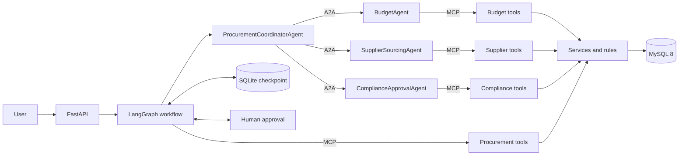
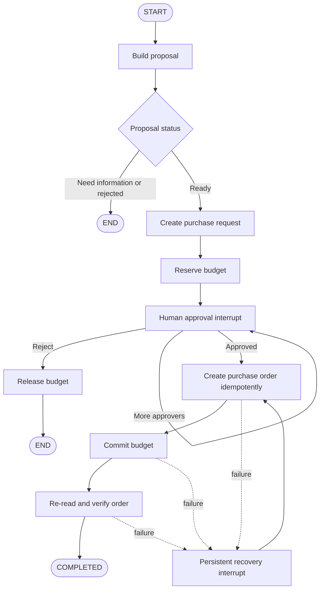

# ProcureFlow｜企业采购多智能体协同系统

ProcureFlow is an enterprise procurement multi-agent system based on LangGraph, A2A and MCP. It converts a natural-language request into a source-grounded procurement proposal, checks budget and suppliers, enforces compliance rules, pauses for human approval, and creates a purchase order through an idempotent transaction path.

The current acceptance result is **PASS**. The final regression contains 85 Phase 1, 52 Phase 2, 18 Phase 3, 12 Phase 4, and 18 amount-safety tests. One bounded real-Qwen rerun passed all 30 fixed scenarios after the amount validation fix.

## Architecture



The system keeps four Agent roles:

| Agent | Responsibility |
|---|---|
| `ProcurementCoordinatorAgent` | Extracts and validates the request, calls specialists through A2A, filters and ranks evidence, and returns a proposal. |
| `BudgetAgent` | Reads department budget evidence and returns a deterministic budget decision. |
| `SupplierSourcingAgent` | Reads active quotes, stock, delivery, supplier status, and performance. |
| `ComplianceApprovalAgent` | Checks qualifications, procurement rules, quote counts, and the required approval chain. |

Agents do not import repositories, services, or MySQL clients. Read operations cross MCP boundaries, and workflow writes cross the procurement MCP boundary. The LLM is limited to structured extraction, constrained tool selection, and explanation factors. Decimal calculations, filtering, scoring, compliance, approval authorization, and purchase-order writes remain deterministic.

## Workflow safety



High-risk monetary fields receive a second validation before any A2A, MCP, or database action. The validator accepts only amounts tied to clear total-budget or unit-price evidence, supports `元`, `万元`, comma-formatted numbers, and Chinese amounts, and keeps quantity, dimensions, and delivery days separate. A clear model mismatch is corrected from the source span. Ranges, vague amounts, or unclear monetary meaning return `NEED_MORE_INFORMATION` and never enter the write workflow.

## Evaluation

| Suite | Result |
|---|---:|
| Phase 1 | 85 passed |
| Phase 2 | 52 passed |
| Phase 3 | 18 passed |
| Phase 4 | 12 passed |
| Final amount-safety tests | 18 passed |
| Deterministic and fault scenarios | 60/60 |
| Real Qwen scenarios | 30/30 |
| Write-through workflow scenarios | 6/6 |

The real-Qwen run used `qwen-plus-latest` for 30 fixed cases and made 118 calls: 30 extraction, 68 tool-selection, and 20 explanation calls. Applicable checks passed at 30/30 requirement parsing, 23/23 budget decisions, and 20/20 supplier filtering, compliance, and recommendation validity. These are fixed low-concurrency acceptance cases, not a production accuracy or capacity claim.

The database remained at 16 tables and 398,869 synthetic rows. Before/after row counts, every table-content SHA-256, and schema SHA-256 were equal. The schema digest was `a3db37a667f444c9d646d5213e73f14c60331abf340ddf1a7884bacfeefbde4d`.

## Local setup

Requirements:

- Python 3.12
- Docker Desktop or Docker Engine with Compose
- a DashScope API key for real-LLM flows

Create a virtual environment and copy the environment template.

```powershell
py -3.12 -m venv .venv
.\.venv\Scripts\python.exe -m pip install -r requirements-phase3-lock.txt
Copy-Item .env.example .env
```

```bash
python3.12 -m venv .venv
./.venv/bin/python -m pip install -r requirements-phase3-lock.txt
cp .env.example .env
```

Set database passwords in `.env`. Set `DASHSCOPE_API_KEY` only in the process environment. Neither file nor key should be committed.

`PROCUREFLOW_DATA_ROOT` controls MySQL bind mounts, generated datasets, logs, and the SQLite checkpoint. The public example uses `./.procureflow-data`; absolute Windows, Linux, and macOS host paths are supported. The final local acceptance used `E:/ProcureFlowData` through a private `.env`, but the code has no E-drive requirement and does not use `P:` or `SUBST` paths.

Prepare and start MySQL:

```powershell
.\.venv\Scripts\python.exe -m scripts.docker_mysql prepare
docker compose up -d mysql
.\.venv\Scripts\python.exe -m scripts.docker_mysql inspect
```

For a fresh synthetic database, run the generator, loader, and audit after MySQL is healthy:

```powershell
.\.venv\Scripts\python.exe -m scripts.generate_procurement_dataset
.\.venv\Scripts\python.exe -m scripts.load_procurement_dataset
.\.venv\Scripts\python.exe -m scripts.audit_dataset
```

Start the four MCP servers, four A2A endpoints, and workflow API:

```powershell
.\.venv\Scripts\python.exe -m scripts.phase3_stack
```

Open `http://127.0.0.1:8010/docs` for the API. The launcher stops only the child services it created; MySQL remains managed by Compose.

## Tests

```powershell
# Phase 1
.\.venv\Scripts\python.exe -m pytest tests -q `
  --ignore=tests\phase2 --ignore=tests\phase3 `
  --ignore=tests\phase4 --ignore=tests\final_bugfix

# Phase suites and final fix
.\.venv\Scripts\python.exe -m pytest tests\phase2 -q
.\.venv\Scripts\python.exe -m pytest tests\phase3 -q
.\.venv\Scripts\python.exe -m pytest tests\phase4 -q
.\.venv\Scripts\python.exe -m pytest tests\final_bugfix -q
```

The real-LLM evaluator is intentionally separate because it calls a paid external model. Run it at most once for the fixed 30-case set when a fresh external verification is required:

```powershell
.\.venv\Scripts\python.exe -m scripts.evaluate_phase4 llm
```

## Limits

- This is a local engineering and acceptance environment, without production authentication, TLS, approval delegation, audit signatures, or multi-instance locking.
- SQLite checkpointing targets a single-machine demo. Multi-worker deployment needs a production state store and concurrency control.
- The procurement model is single-request, single-supplier, and single-currency. It does not implement tax, split orders, receiving, returns, payment, or live supplier APIs.
- Amount validation is deliberately conservative. Ambiguous language asks for clarification instead of guessing.
- Token usage is unavailable because the validated gateway does not retain provider usage metadata.

## Reports and provenance

- [Final bugfix report](reports/FINAL_BUGFIX_REPORT.md)
- [Phase 4 final report](PHASE4_FINAL_REPORT.md)
- [Phase 4 evaluation](reports/PHASE4_EVALUATION.md)
- [Architecture audit](reports/PHASE4_ARCHITECTURE_AUDIT.md)
- [Publication rights audit](reports/PUBLICATION_RIGHTS_AUDIT.md)
- [Project provenance](PROVENANCE.md)

No license is granted by this repository unless the owner adds an explicit license file. Third-party packages remain governed by their own licenses.
