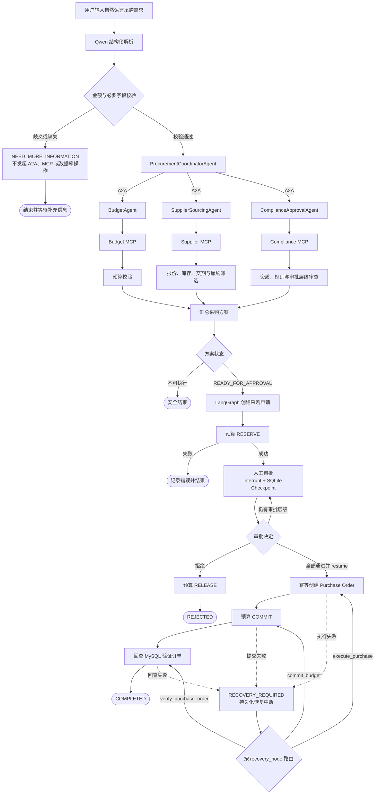
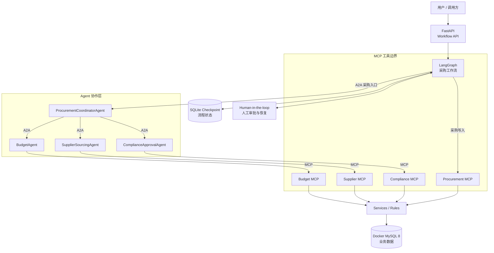

<div align="center">

# ProcureFlow

### 企业采购多智能体协同系统

从自然语言采购需求到供应商寻源、预算校验、合规审批和采购订单执行的多 Agent 协同系统。

<p>
  
  
  
  
  
  
  
  
  
</p>

</div>

## 项目简介

企业采购往往同时涉及需求澄清、供应商报价与履约证据、部门预算、采购规则和多级审批。信息分散在不同业务环节时，单一模型既难以保持职责边界，也不适合直接决定预算和下单等高风险操作。

ProcureFlow 将流程拆分为采购协调、供应商寻源、预算和合规四个 Agent：Coordinator 通过 A2A 分派专业任务，各专业 Agent 通过 MCP 读取结构化业务工具，LangGraph 再编排采购申请、人工审批和采购订单执行。Qwen 负责自然语言理解与结构化提取；金额计算、候选过滤、审批授权、预算状态迁移和订单写入由确定性规则与数据库事务完成。

系统不会让 Agent 独立替代人工审批。高风险采购在进入执行前必须经过规则校验和 Human-in-the-loop 审批，并通过持久化 Checkpoint、幂等写入和故障恢复保持过程可控、可追溯。

> 核心原则：自然语言交给模型理解，确定性业务交给规则执行，高风险动作交给人工确认。

## 核心业务流程



## 四个 Agent 的职责边界

| Agent | 主要输入 | 核心职责 | 主要输出 |
|---|---|---|---|
| `ProcurementCoordinatorAgent` | 自然语言需求、请求标识 | 提取并校验需求，通过 A2A 调用三个专业 Agent，汇总证据并生成采购方案；不直接访问数据库 | 结构化需求、预算与合规结论、候选供应商、推荐方案 |
| `SupplierSourcingAgent` | 产品、数量、价格上限、交期 | 通过 MCP 查询报价、库存、交期、供应商状态和历史履约表现；提供供应商证据，不决定最终审批 | 候选报价、供应商详情、履约指标、筛选警告 |
| `BudgetAgent` | 部门编码、采购金额 | 通过 MCP 读取部门预算并执行确定性额度判断；不直接预占、释放或提交预算 | 可用额度、预算是否充足、采购后余额、原因 |
| `ComplianceApprovalAgent` | 部门、供应商、品类、金额、有效报价数 | 通过 MCP 审查供应商资质、采购规则和所需审批层级；不代替人工审批 | 合规结论、规则证据、审批链与失败原因 |

这种拆分让每个 Agent 只消费职责所需的结构化证据。Coordinator 负责协同，专业 Agent 负责判断依据，真正的预算变更和采购写入由 LangGraph 工作流通过 Procurement MCP 执行。

## 技术架构



- **A2A** 承担 Agent 之间的网络协作与任务分派。
- **MCP** 暴露预算、供应商、合规和采购工具，是 Agent/Workflow 访问业务能力的边界。
- **MySQL** 保存正式业务数据；**SQLite** 只保存 LangGraph 的单机流程 Checkpoint。

## 关键技术实现

### 1. A2A + MCP 多智能体协作

系统保留四个职责明确的 Agent。Coordinator 不导入专业 Agent 或数据仓储实现，而是通过 A2A 调用独立端点；Budget、Supplier、Compliance Agent 再按允许的工具集合通过 MCP 读取事实。返回结果经过 Pydantic 结构校验和请求/实体标识核对，避免模型生成的内容绕过业务工具成为事实。

### 2. LangGraph 状态管理与人工审批

唯一的主采购 Graph 显式保存需求、方案、采购申请、预算状态、审批链、订单和错误信息。Conditional Edge 根据方案状态、审批结果和故障类型路由；`interrupt` 暂停在审批或恢复节点，`resume` 可在 Checkpoint 上继续执行。SQLite Checkpoint 支持本地跨进程恢复，多级审批逐级校验审批人角色，拒绝路径释放预算并终止流程。

### 3. 确定性规则与采购执行

预算判断、供应商资质与报价过滤、库存和交期检查、候选排序、合规规则及审批链均由结构化工具和规则完成。金额使用 `Decimal` 计算；采购执行依次完成 `RESERVE / RELEASE / COMMIT` 状态迁移。Purchase Order 通过幂等键和数据库事务创建，写入后再次回查订单；暂时性执行错误会进入可恢复中断，并从原故障节点重试。

### 4. Qwen 需求解析与金额安全校验

Qwen 将自然语言需求提取为结构化字段，规则层在任何 Agent 分派前对高风险金额做第二次原文对齐。校验器识别总预算与单价标签，支持元、万元、带千分位数字和中文金额，并隔离数量、尺寸与交期数字。无金额单位、相邻“60 天”等数字造成的错误已通过原文数值对齐修复；金额区间、模糊表达或语义冲突会返回 `NEED_MORE_INFORMATION`，不会进入预算预占或下单流程。

## 项目结构

```text
ProcureFlow/
├─ agents/                 # 四个 Agent、A2A 传输、LLM 与金额安全校验
├─ a2a_server/             # 采购协调及三个专业 Agent 的 A2A 服务端点
├─ mcp_server/             # Budget / Supplier / Compliance / Procurement MCP
├─ workflow/               # LangGraph、状态、路由、审批、恢复与 Checkpoint
├─ services/               # 确定性业务服务、规则、模型与错误定义
├─ api/                    # FastAPI 工作流接口
├─ db/                     # MySQL 连接与 Repository 数据访问层
├─ sql/                    # 业务表和索引定义
├─ scripts/                # 数据生成、导入、服务启动、评测与验收脚本
├─ tests/                  # Phase 1—4 与最终金额安全回归测试
├─ deploy/mysql/init/      # Docker MySQL 初始化脚本
├─ reports/                # 可公开的验收、架构与发布审计证据
├─ docker-compose.yml      # 本地 MySQL 8 编排
├─ requirements-phase3-lock.txt
└─ .env.example            # 不含真实凭据的配置模板
```

## 快速启动

### 1. 环境要求

- Python 3.12
- Docker Desktop，或支持 Compose 的 Docker Engine
- 运行真实模型流程时使用 DashScope API Key

### 2. 创建环境并安装依赖

以下命令以 Windows PowerShell 为主：

```powershell
py -3.12 -m venv .venv
.\.venv\Scripts\python.exe -m pip install -r requirements-phase3-lock.txt
Copy-Item .env.example .env
```

在忽略提交的 `.env` 中设置 `DB_PASSWORD`、`MYSQL_ROOT_PASSWORD` 等数据库配置。模型密钥只通过进程环境变量提供：

```powershell
$env:DASHSCOPE_API_KEY = "<your-dashscope-api-key>"
```

`PROCUREFLOW_DATA_ROOT` 控制 MySQL bind mount、生成数据、日志和 SQLite Checkpoint 的位置。默认值 `./.procureflow-data` 可直接使用，也可改为 Windows、Linux 或 macOS 的绝对路径；项目不要求使用特定盘符。

### 3. 准备并启动 Docker MySQL

```powershell
.\.venv\Scripts\python.exe -m scripts.docker_mysql prepare
docker compose up -d mysql
.\.venv\Scripts\python.exe -m scripts.docker_mysql inspect
```

### 4. 生成并导入可复现合成数据

```powershell
.\.venv\Scripts\python.exe -m scripts.generate_procurement_dataset
.\.venv\Scripts\python.exe -m scripts.load_procurement_dataset
.\.venv\Scripts\python.exe -m scripts.audit_dataset
```

### 5. 启动 MCP、A2A 与 Workflow API

```powershell
.\.venv\Scripts\python.exe -m scripts.phase3_stack
```

启动器会拉起 4 个 MCP 服务、4 个 A2A 端点和 FastAPI Workflow API。Swagger 地址：`http://127.0.0.1:8010/docs`。

### 6. 运行回归测试

```powershell
# Phase 1
.\.venv\Scripts\python.exe -m pytest tests -q `
  --ignore=tests\phase2 --ignore=tests\phase3 `
  --ignore=tests\phase4 --ignore=tests\final_bugfix

# Phase 2—4 与最终修复
.\.venv\Scripts\python.exe -m pytest tests\phase2 -q
.\.venv\Scripts\python.exe -m pytest tests\phase3 -q
.\.venv\Scripts\python.exe -m pytest tests\phase4 -q
.\.venv\Scripts\python.exe -m pytest tests\final_bugfix -q
```

Linux/macOS 使用 `python3.12 -m venv .venv`、`./.venv/bin/python` 和 `cp .env.example .env`，其余模块命令与 Compose 流程一致。真实 Qwen 评测会调用收费外部模型，因此不属于日常启动或回归步骤。

## 评测与验收结果

| 验证范围 | 最终结果 | 说明 |
|---|---:|---|
| Pytest 回归 | **185 passed** | Phase 1 `85` + Phase 2 `52` + Phase 3 `18` + Phase 4 `12` + 最终金额安全 `18` |
| Phase 2 Agent 受控 E2E | **50 条** | 真实 Qwen、A2A、MCP 与 MySQL 的历史固定场景集 |
| Phase 3 Workflow 受控 E2E | **30 条** | 覆盖 LangGraph、审批、Checkpoint、采购执行与恢复 |
| Phase 4 确定性与故障场景 | **60/60** | 包含确定性方案与故障注入 |
| Phase 4 Workflow 写入场景 | **6/6** | 校验审批路由、预算一致性、PO 完整性和幂等性 |
| 真实 Qwen 固定场景复测 | **30/30** | 修复前严格需求提取 `27/30`；针对数值问题修复后，同一固定案例集为 `30/30` |
| 数据库完整性 | **16 表 / 398,869 行** | 可复现合成数据；前后逐表内容与 Schema 摘要一致 |

这些结果来自不同阶段的受控验收集，样本范围和验证目的不同，不应相加为统一准确率。`30/30` 只说明已修复场景在同一固定案例集上通过，不代表未知输入的通用准确率或生产容量。

## 数据与工程边界

- 398,869 条记录均为脚本生成的可复现合成数据，不是真实企业生产数据。
- 当前系统面向本地工程演示和受控验收；SQLite Checkpoint 适合单机场景。
- 当前采购模型以单申请、单供应商和单币种为主，尚未覆盖完整 ERP 的付款、收货、退货、税费和复杂拆单流程，也未接入实时供应商系统。
- 当前未提供生产级身份认证、TLS、分布式状态存储、多实例锁和完整可观测性保障。
- 金额校验采用保守策略；含义不明确时要求补充信息，不进行猜测。
- 修复后的真实 Qwen `30/30` 是固定场景复测结果，不能代表所有未知自然语言输入。
- 本仓库当前没有项目许可证；除非仓库所有者添加明确的许可证文件，否则不授予项目代码许可。第三方依赖遵循各自许可证。

## 相关报告

- [Phase 4 最终报告](PHASE4_FINAL_REPORT.md)
- [最终错误修复报告](reports/FINAL_BUGFIX_REPORT.md)
- [Phase 4 综合评测](reports/PHASE4_EVALUATION.md)
- [架构审计](reports/PHASE4_ARCHITECTURE_AUDIT.md)
- [发布权利审计](reports/PUBLICATION_RIGHTS_AUDIT.md)
- [项目来源说明](PROVENANCE.md)
